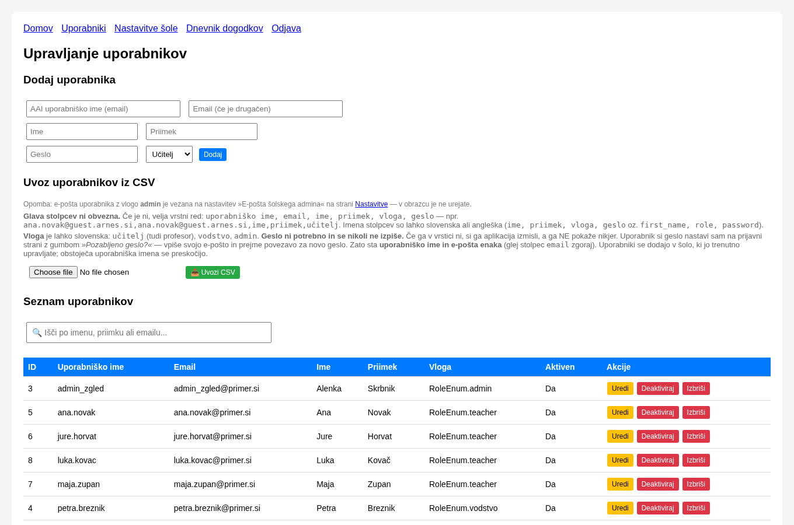
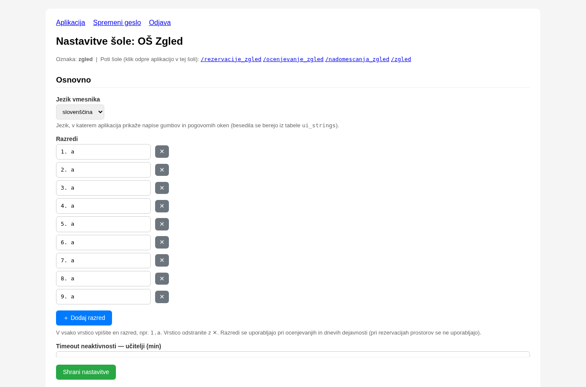
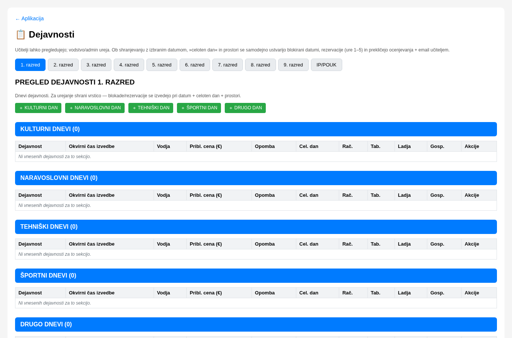
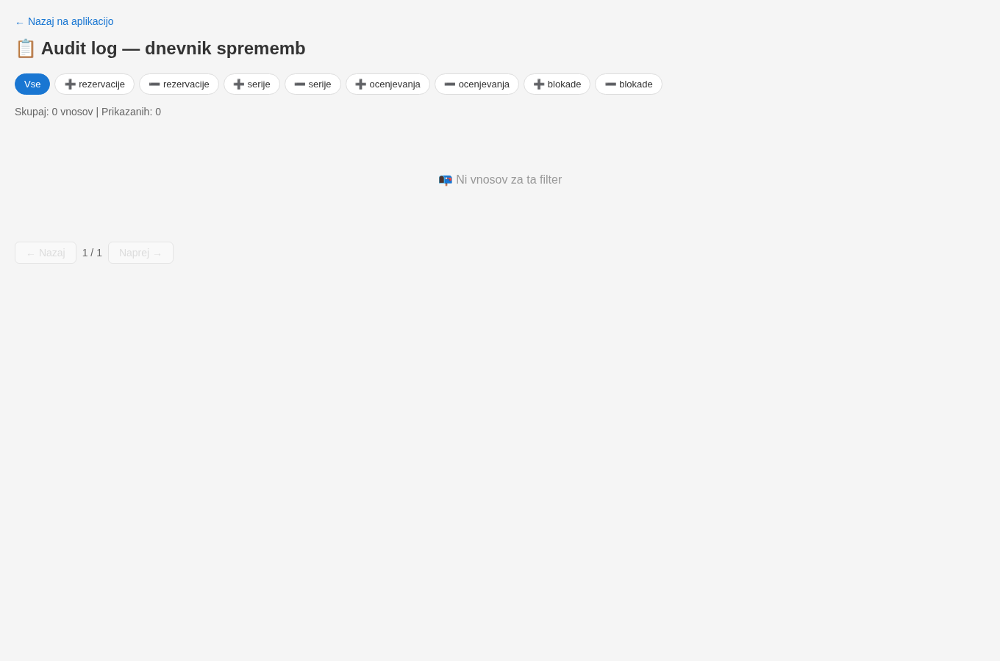

---

> 🛠️ **Namenjeno izključno administratorju šole** (skrbniku sistema).
> Vodstvo in učitelji tega dokumenta ne vidijo.
>
> Administrator skrbi za **nastavitve šole, uporabnike, e-pošto, naročnino in
> varnostne kopije**. Za vsakodnevno delo (rezervacije, ocenjevanja) glejte
> *Navodila za vodstvo* in *Navodila za učitelje*.

---

# 🛠️ Navodila za administratorja 

---

## 1. Kje je kaj

| Kaj | Kje |
|---|---|
| 👥 **Uporabniki** (računi učiteljev, vodstva) | Zgornji meni → **Admin panel**  |
| ⚙️ **Nastavitve šole** (razredi, prostori, števila, urnik, e-pošta) | Zgornji meni → **⚙️ Nastavitve šole**  |
| 🧭 **Navodila za nastavitev šole** (kaj še urediti) | <code>/nastavitev</code> |
| 💶 **Naročnina šole** | ⚙️ Nastavitve šole → razdelek *Naročnina šole* (ali <code>/narocnina</code>) |
| 💾 **Varnostna kopija in obnova** | ⚙️ Nastavitve šole → *Varnostna kopija* / *Obnova* |
| 🗓️ **Dnevi dejavnosti** | Stran **Vnos dejavnosti** (zavihek *Ocenjevanje in dnevi dejavnosti*, <code>/dejavnosti</code>) ali **koledar** |
| 📋 **Dnevnik sprememb (audit log)** | Zgornji meni → **📋 Audit log** |

> 💡 **Namig:** Skoraj vse administratorjeve nastavitve so na enem mestu —
> v **Nastavitvah šole**. Spremembe veljajo takoj po shranjevanju.

---

## 2. Uporabniki

Uporabniško ime uporabnika je **njegov šolski e-poštni naslov**. Gesla se
**nikjer ne izpisujejo** — vsak uporabnik si ga nastavi sam prek gumba
**Pozabljeno geslo?** na prijavni strani.

### Ročni vnos uporabnikov

Priporočljivo **samo med šolskim letom** (ko nastopi nov učitelj sredi leta in ga
je treba dodati sproti). Na začetku šolskega leta je bolje uporabiti uvoz
(glej spodaj).

### Uvoz iz CSV datoteke

Na strani **Uporabniki** izberete CSV datoteko in kliknete **📥 Uvozi CSV**.
Glava stolpcev ni obvezna; privzeti vrstni red je
`uporabniško ime, email, ime, priimek, vloga, geslo`. Geslo lahko izpustite —
aplikacija si ga izmisli in ga **ne pokaže**. Obstoječa uporabniška imena se
preskočijo.

### Uvoz zaposlenih s skripto

Skripta **samodejno prebere seznam zaposlenih kar s šolske spletne strani** — ni
ročnega vnašanja, ni Excel tabel. Prebere vse tabele z zaposlenimi (vodstvo,
učitelje, administracijo, tehnično osebje). Skripta samo **bere**, na spletni
strani ničesar ne spreminja.

```bash
cd /home/admin/reservation_app
python3 scripts/import_teachers.py --base-url https://ostc-app.org

# Preizkus (brez dejanskih sprememb) — pokaže, koga bi uvozilo:
python3 scripts/import_teachers.py --dry-run

# Z administracijo in tehničnim osebjem:
python3 scripts/import_teachers.py --base-url https://ostc-app.org --include-all
```

### Upravljanje uporabnikov

**Dostop:** V zgornji navigaciji kliknite **Admin panel**.



| Funkcija | Opis |
|---|---|
| Dodajanje | Vnesete e-pošto, ime, priimek, geslo, vlogo |
| Pregled | Tabela vseh uporabnikov — klik na stolpec za razvrščanje |
| Urejanje | Kliknite »Uredi«. Če geslo pustite prazno, ostane nespremenjeno |
| Deaktivacija / Aktivacija | Uporabniku onemogočite ali ponovno omogočite dostop |
| Brisanje | Trajno izbriše uporabnika (glavni admin, ID=1, je zaščiten) |
| Sprememba gesla | Admin lahko kadarkoli spremeni geslo uporabniku |

---

## 3. Nastavitve šole

Na strani **⚙️ Nastavitve šole** uredite vse, kar določa delovanje za vašo
šolo. Po vsaki spremembi kliknite **Shrani nastavitve**.



| Razdelek | Kaj urejate |
|---|---|
| **Razredi** | Seznam oddelkov. Vsak razred v svoji vrstici; dodate z **＋ Dodaj razred** |
| **Števila** | Imenovane številske spremenljivke (npr. `Število tablic = 28`) |
| **Prostori** | Prostori za rezervacijo. Kljukica **»število«** poveže prostor s številsko spremenljivko — tak prostor si lahko izposodi več učiteljev hkrati (vsak navede količino) |
| **Urnik** | Ure pouka (npr. `07:30-08:15`) |
| **Pravila ocenjevanja** | Največ ocenjevanj na teden / dan / z ponavljanjem / zaporednih dni |
| **E-pošta (SMTP)** | Naslov admina, naslov pošiljatelja (From), naslov za varnostne kopije, SMTP strežnik, uporabniško ime in geslo |

### Razredi = skupine od 1. do 9. razreda

V polju **Razredi** vpišete vse oddelke (skupine) šole — **od 1. do 9. razreda**.
Vsak razred v svojo vrstico, npr. `1.a`, `1.b`, `2.a`, … `9.č`. Uporabljajo se
pri rezervacijah, ocenjevanjih in **dnevih dejavnosti**, zato morajo biti vpisani
točno tako, kot jih šola uporablja.

> ℹ️ Za **8. in 9. razred** se pogosto uporabljajo *skupinsko-razredne oznake*
> (npr. `8. a` in `8. 1`), kjer številka pomeni skupino. Vpišite jih enako kot
> velja pri vas — aplikacija jih obravnava kot ločene razrede.

> 🔒 **Geslo SMTP se nikoli ne izpiše.** Če polje pustite prazno, se obstoječe
> geslo **ohrani**. Novo geslo vpišete le, ko ga želite zamenjati.

### Prostor z več enotami (npr. 5 računalnikov)

1. V razdelku **Števila** dodajte spremenljivko `Število računalnikov = 5`.
2. V razdelku **Prostori** dodajte prostor in obkljukajte **»število«** ter ga
   povežite s to spremenljivko.
3. Zdaj si lahko več učiteljev hkrati izposodi isto enoto — skupna vsota na uro
   je omejena s spremenljivko. Brez kljukice je prostor ekskluziven (ena
   rezervacija na uro).

---

## 4. E-pošta (SMTP)

Brez pravilno nastavljene e-pošte **obvestila in obnovitev gesla ne delujeta**.

| Nastavitev | Kaj je |
|---|---|
| **ADMIN_EMAIL** | Naslov šolskega admina — prejema obvestila in povezavo za obnovitev gesla |
| **MAIL_FROM** | Naslov pošiljatelja (From). Nova šola dobi testni naslov `test@example.invalid` — zamenjajte ga s svojim, sicer pošte ni mogoče dostaviti |
| **BACKUP_EMAIL** | Kam naj gre nočna varnostna kopija |
| **MAIL_SERVER / MAIL_USERNAME / MAIL_PASSWORD** | Podatki SMTP strežnika (če šola uporablja Arnes, vpišite podatke Arnesa) |

---

## 5. Naročnina šole

Šola potrebuje **veljavno naročnino** (tudi pri ceni 0 € jo je treba redno
obnoviti), sicer se učitelji ne morejo prijaviti — prijavi se lahko le
administrator šole.

- V **Nastavitvah šole → Naročnina šole** vidite stanje in veljavnost.
- Gumb **Kupi / Podaljšaj naročnino** vodi na stran naročnine, kjer izberete
  obdobje, plačate in **sporočite plačilo**.
- Naročnino potrdi ponudnik aplikacije, ko je nakazilo prejeto.
- **Samodejno obnavljanje:** če ga vklopite in uredite plačilo prek PayPala, se
  naročnina obnavlja sama ob vsakem obdobju.

> 💶 Trenutno je na voljo **letni** plan (12 mesecev).

---

## 6. Varnostna kopija in obnova

### Naredi backup

V **Nastavitvah šole → Varnostna kopija šole** kliknite **📧 Naredi backup**.
Aplikacija sestavi `.sql` kopijo podatkov **samo te šole** in jo pošlje na
**E-pošto za varnostne kopije** (BACKUP_EMAIL). Poleg tega se vsako noč pripravi
samodejna kopija.

### Obnova iz kopije

V **Nastavitvah šole → Obnova iz varnostne kopije** naložite `.sql` datoteko in
izberite, kaj naj se obnovi. Podatki izbrane skupine **za to šolo** se zamenjajo
s podatki iz kopije; podatki drugih šol ostanejo nedotaknjeni.

| Gumb | Kaj obnovi |
|---|---|
| 👥 Uporabniki | Račune šole (z gesli) |
| ⚙️ Nastavitve | Razrede, prostore, urnik, števila |
| 📋 Dejavnosti | Dneve dejavnosti + zasedene datume |
| 📅 Rezervacije | Rezervacije prostorov |
| 📝 Ocenjevanje | Ocenjevanja |
| ♻️ Celotna šola (vse) | Ponovno postavi vso šolo iz kopije |

> ⚠️ Obnova **zamenja** obstoječe podatke izbrane skupine. Vsaka obnova se
> zabeleži v dnevnik dogodkov.

---

## 7. Dnevi dejavnosti — kaj in kako dela

**Dan dejavnosti** je dan, ko razred ne more pisati ocenjevanj in (običajno) ni
pouka — npr. športni dan, kulturni dan, naravoslovni dan, tehniški dan, ekskurzija,
šolska prireditev.



Dejavnosti se urejajo na strani **Vnos dejavnosti** (povezava v zavihku
*Ocenjevanje in dnevi dejavnosti*, pot `/dejavnosti`). Ureja jih **vodstvo ali
admin**; učitelji stran vidijo samo za branje. Vsak razred (generacija od 1. do 9.)
ima svoj zavihek.

### Kako se doda

1. Odprite razred (zavihek **1.–9.**) in kliknite **＋ [vrsta] DAN** (npr.
   **＋ ŠPORTNI DAN**) ali **＋ Dodaj dogodek / tedensko rezervacijo**.
2. Vpišite **naziv** dejavnosti in po potrebi **pod dejavnost**.
3. Obkljukajte **»Celoten dan«**, če dejavnost traja ves dan (glej spodaj).
4. V razdelku **Datumi** vpišite datum (**Od**) in izberite **razrede**
   (posamezne oddelke npr. `3. a`, `3. b` — ali **Vsi razredi generacije**).
5. Po potrebi izberite **prostore** (npr. telovadnico) in **vodjo** ter shranite.

### Večdnevna dejavnost (npr. ekskurzija za več dni)

1. V razdelku **Datumi** kliknite **＋ Dodaj datum**.
2. Vpišite **Od** (prvi dan).
3. Obkljukajte **»Več dni«** in v polje **Do** vpišite **zadnji dan**.
4. Shranite — dejavnost velja **za vsak zaporedni dan v tem obsegu** (za izbrane
   razrede). Vsak dan posebej se zablokira za ocenjevanja in (ob izbranih
   prostorih) rezervira ure 1–5.

> 💡 Za isto dejavnost lahko dodate tudi **več ločenih datumov** (vsak s svojimi
> razredi) — kliknete **＋ Dodaj datum** tolikokrat, kolikor terminov potrebujete.

### Kako vpliva

| Nastavitev | Kaj pomeni |
|---|---|
| **»Celoten dan« (obkljukano)** | Dan se **zablokira za ocenjevanja** za izbrane razrede — obstoječa ocenjevanja na ta dan se izbrišejo, prizadeti učitelji pa prejmejo obvestilo po e-pošti. Če so izbrani prostori, se **rezervirajo ure 1–5** v teh prostorih. Dan se prikaže v koledarju (vijolično polje **Dejavnosti:**). |
| **»Celoten dan« (brez kljukice)** | Krajša dejavnost: ocenjevanja **niso** blokirana in dan se v koledarju ne prikaže kot blokada. Primerno, kadar dejavnost traja le del dneva. |
| **Ročna blokada v koledarju** | Če želite zaseden dan **brez** zapisa v dejavnostih, ga označite v **koledarju** na glavni strani (gumb za dneve dejavnosti: izberete razrede in obdobje). Taka blokada v dejavnostih nima zapisa — v koledarju je označena kot »ročno blokirano«. |
| **Urejanje / brisanje** | Ko dejavnost uredite ali izbrišete, aplikacija samodejno odstrani stare blokade in rezervacije za ta zapis ter postavi nove — koledar vedno odraža trenutno stanje. |

> ⚠️ Če posamezno rezervacijo izbrišete z `✕` (v rezervacijah), **nihče ne dobi
> obvestila**. Za samodejno obveščanje uporabite dneve dejavnosti.

---

---

## 7b. Govorilne ure

Aplikacija vključuje **najavo staršev na govorilne ure**. Učitelji svoj
**dopoldanski termin** (dan, šolska ura, prostor) in **popoldanski termin**
nastavijo sami na strani **»🗓️ Moje govorilne ure«** (`/govorilne/ure`, prikazana
vsem prijavljenim razen glavnemu adminu). Starši se nato najavijo prek javne
strani **`/govorilne`** (ali poti šole, npr. `/govorilne_ostcj`).

Vlogo ima pri urejanju učiteljev/vodstvo/admin; **glavni admin govorilnih
nastavitev ne vidi** (po nameri — tako je definirano).

| Kaj | Kje |
|---|---|
| Ure popoldanskih govorilnih (nastavljive) | `/govorilne/ure` → učiteljev obrazec |
| Dolžina termina (privzeto 15 min) | `/govorilne/ure` → nastavitve |
| Prijave staršev (pregled) | `/govorilne/prijave` |
| Obvestilo za starše/učitelje | Stran **📄 Obrazci** → PDF |

> 🔒 Prijave staršev se samodejno brišejo **24 ur po koncu termina** — za
> varovanje osebnih podatkov.

---

## 7c. Digitalni zaslon (nadomeščanja)

Na strani **⚙️ Nastavitve šole → Digitalni zaslon** nastavite zaslon, ki v
preddverju/shrambi vrti **nadomeščanja iz eAsistenta** + obvestila šole.

| Nastavitev | Kaj |
|---|---|
| `ZASLON_URL` | Javni URL eAsistentovih nadomeščanj |
| Obvestila (slike + teksti) | Naložite jpg/png/pdf ali dodajte besedilo — vrtijo se po vašem izboru |
| Časovni pas in hitrost drsenja | Prilagodite prikazu |
| **Osveži vse naprave** | Pošlje vsem zaslonom predlogo (reload) — sprememba se pokaže v ≤10 s |

> Zaslon je javen na **`/zasloni`** (ali goli poti šole). Za nadomeščanja iz
> eAsistenta se uporabi javni URL, ki ga admin vnese v nastavitvah.

---

## 7d. Obrazci in obvestila (za vodstvo in admin)

Na strani **📄 Obrazci** (`/obrazci`) so pripravljeni **obvestili za učitelje in
za starše** (npr. obvestilo o govorilnih urah), vsako s predogledom in **PDF**
prenosom — takoj pošljete po e-asistentu ali natisnete. Obvestila so oblikovana
kot A4 dokument.

## 8. Audit log (dnevnik sprememb)

**📋 Audit log** omogoča **pregled vseh pomembnih sprememb v sistemu**

 — kdo je kaj
naredil in kdaj. Uporabno za sledljivost in odpravljanje napak.

| Akcija | Opis |
|--------|------|
| `create_rezervacija` / `delete_rezervacija` | Ustvarjena / izbrisana rezervacija |
| `create_series` / `delete_series` | Ustvarjena / izbrisana serija |
| `create_ocenjevanje` / `delete_ocenjevanje` | Napovedano / izbrisano ocenjevanje |
| `create_blocked_dates` / `delete_blocked_date` | Dodani / odstranjeni dnevi dejavnosti |
| `create_user` / `update_user` / `delete_user` | Spremembe uporabnikov |
| `change_password` | Sprememba gesla |
| `save_selling_settings` | Sprememba nastavitev prodaje |

---

## 9. Priporočila za vloge

| Vloga | Kdo naj jo ima | Pravice |
|---|---|---|
| **Admin** | Samo administrator sistema | Vse — skrbniška plošča, uporabniki, nastavitve, naročnina, kopije |
| **Vodstvo** | Ravnatelj, pomočniki | Rezervacije serij, brisanje tujih rezervacij, dnevi dejavnosti |
| **Učitelj** | Vsi pedagoški delavci | Osnovne rezervacije in ocenjevanja |

**Z eno besedo:** admin skrbi za sistem, vodstvo za urnik, učitelji za pouk.

> Pravilna dodelitev vlog preprečuje težave in zlorabe.

---

> 🛠️ **Opomba:** Pravih gesel in e-naslovov v teh navodilih ni — vse primere
> zamenjajte s svojimi. Gesla se v aplikaciji nikjer ne izpisujejo.
>
> **Avtor:** Matej Čušin
