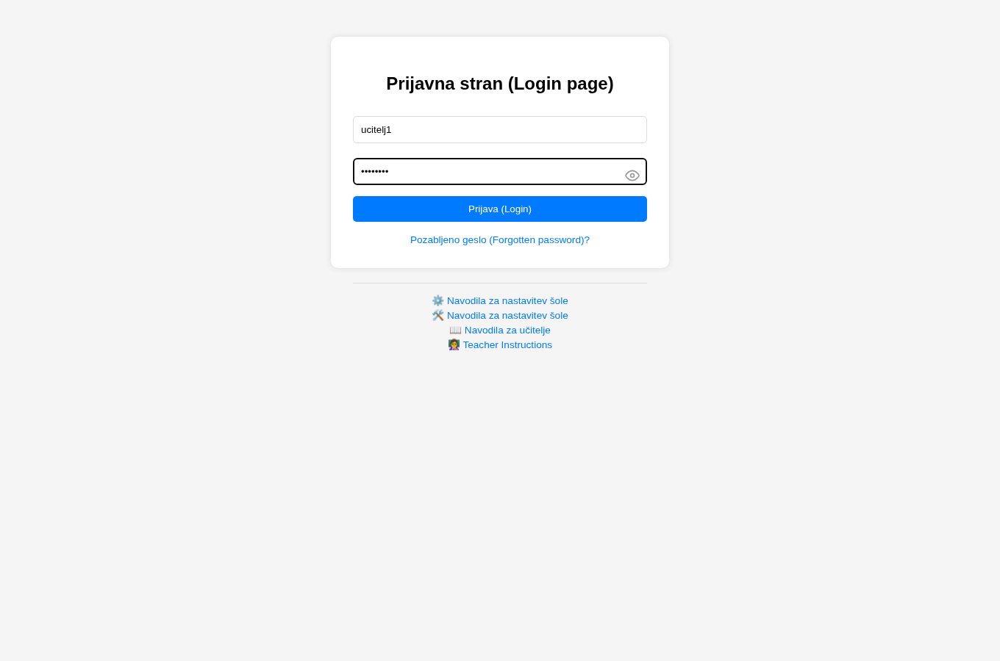
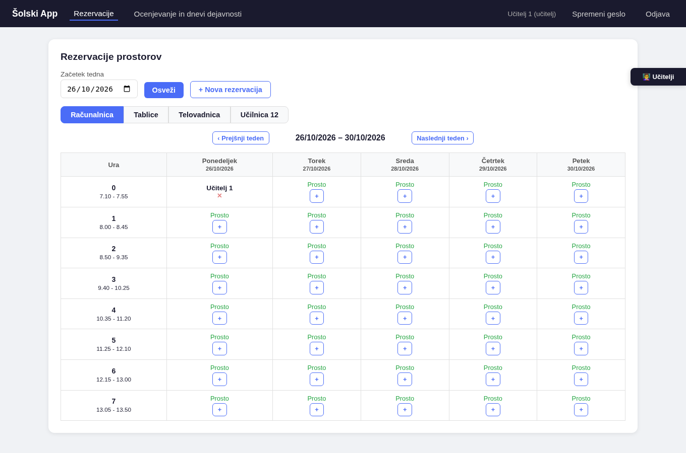
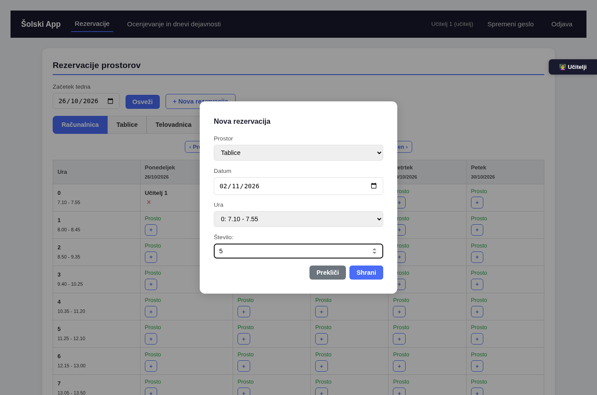
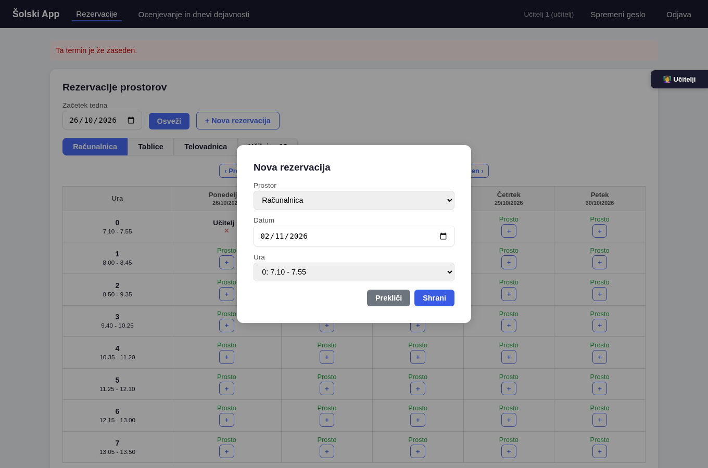
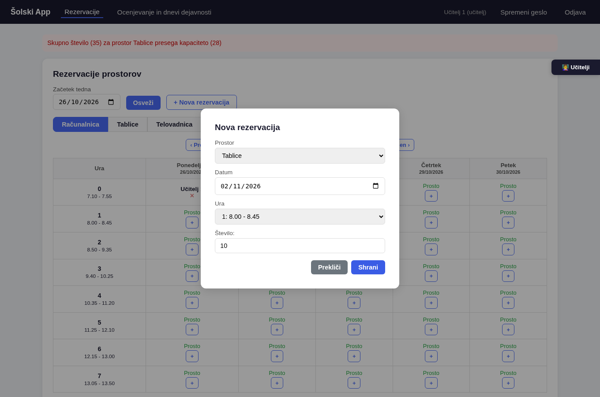
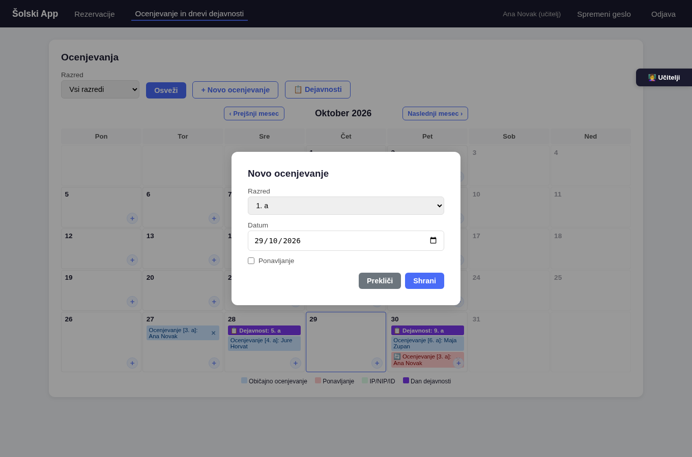
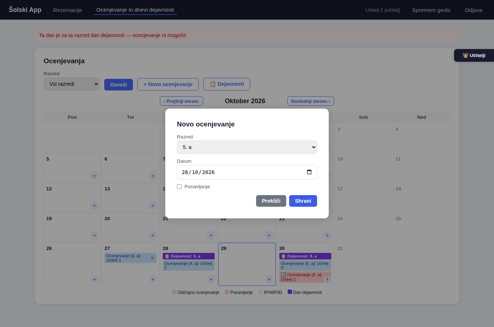
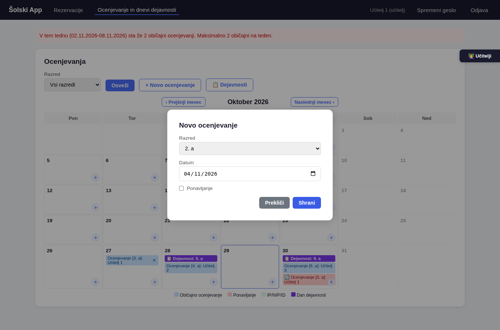
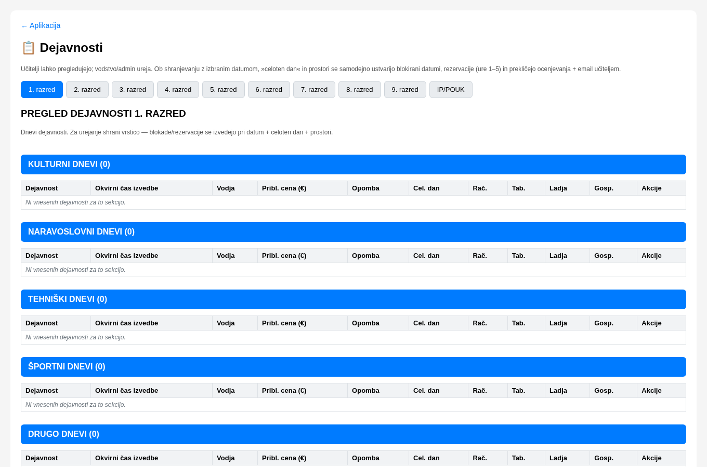
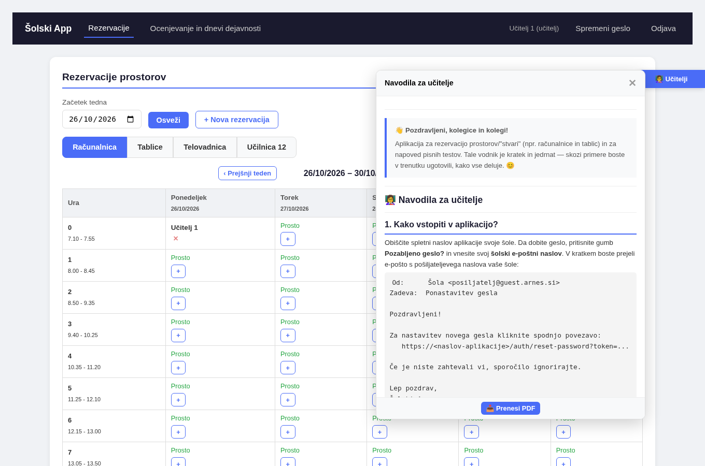

---

> Aplikacija za rezervacijo prostorov in opreme (npr. računalnic in tablic), pregled dejavnosti razredov ter napoved pisnih testov.

---

# 👩‍🏫 Navodila za učitelje

---

## 1. Kako vstopiti v aplikacijo?

Obiščite spletni naslov [aplikacije](https://reservationapp.site).
Če gesla še nimate, kliknite gumb **Pozabljeno geslo?** in vnesite svoj **šolski e-poštni naslov**. V kratkem boste na ta naslov prejeli e-pošto z naslova vaše šole:

```text
Od:      Šola <posiljatelj@guest.arnes.si>
Zadeva:  Ponastavitev gesla

Pozdravljeni!

Za nastavitev novega gesla kliknite spodnjo povezavo:
   https://<naslov-aplikacije>/auth/reset-password?token=...

Če je niste zahtevali vi, sporočilo ignorirajte.

Lep pozdrav,
Šolski App

```

Če sporočila ne prejmete, najprej preverite še mapo **neželena pošta (spam)**. Če ga ni, sami še nekajkrat poskusite ponastaviti geslo in šele nato kontaktirajte administratorja, ki naj preveri, ali je vaš e-poštni naslov pravilno vnesen (pri tem navedite svoj pravilni naslov).

---

## 2. Nastavitev gesla

V prejetem e-sporočilu kliknite na povezavo in nastavite novo geslo.

<p>Geslo mora biti:</p>
<ul>
  <li>✅ Vsaj <strong>5 znakov</strong></li>
  <li>✅ Vsaj <strong>ena mala črka</strong></li>
  <li>✅ Vsaj <strong>ena VELIKA črka</strong></li>
  <li>✅ Vsaj <strong>ena številka</strong></li>
</ul>


---

## 3. Prijava

Ko ste geslo nastavili, se prijavite:

| Polje | Vnesite |
|---|---|
| **Uporabniško ime** | Vaš šolski e-poštni naslov |
| **Geslo** | Geslo, ki ste ga nastavili |



> ⚠️ Če prijava ne deluje, najprej sami še nekajkrat poskusite ponastaviti geslo. Administratorja kontaktirajte šele, ko se težava ne reši.

---

## 4. Rezervacije

Katere prostore lahko rezervirate, je odvisno od **nastavitev vaše šole**. Poznamo dve vrsti:

| Vrsta prostora | Kako deluje? |
|---|---|
| **Ekskluzivni prostor** | Samo **ena** rezervacija na termin (npr. računalnica) |
| **"Prostor" z več enotami** | Več učiteljev lahko rezervira **sočasno** — vsak navede količino, skupna vsota na uro pa je omejena s kapaciteto "prostora" (npr. tablice) |



Rezerviramo lahko na **2 načina**:

**Način 1 — klik na gumb `+` v tabeli:**
Datum se samodejno nastavi na datum, pri katerem ste pritisnili `+` (datum lahko tudi ročno spremenite).

**Način 2 — klik na gumb `Nova rezervacija`:**
Vse podatke nastavite v oknu, ki se odpre.



V tem oknu izberete **Prostor** iz spustnega menija; ure so po urniku vaše šole. Pri prostoru z več enotami izberete tudi **količino** — pri vsakem je prikazano, koliko enot je še prostih (oblika `x/N`).

> ⚠️ **Opomba:** Če je prostor z več enotami za posamezen termin že delno rezerviran, rezervacije prek gumba `+` ni mogoče izvesti — uporabite gumb **Nova rezervacija**.

**Kaj se zgodi, ko termin ni na voljo?** Sistem shranjevanja tega ne dovoli in prikaže **rdeče opozorilo z razlogom**:


*Če izberete termin, ki je že zaseden, se prikaže opozorilo in rezervacija se ne shrani.*


*Pri prostorih z več enotami (npr. tablice) lahko rezervirate le toliko, da skupno število ne preseže kapacitete.*


**Brisanje rezervacije:**
Vodstvo lahko briše **katero koli** rezervacijo, učitelji pa **samo svoje**. Vodstvo ima na voljo tudi serijske rezervacije; priporočamo, da jih večino ustvari na strani **Dejavnosti** (`/dejavnosti`).

---

## 5. Ocenjevanje

Ocenjevanje lahko napoveste na **2 načina**:

**Način 1 — s klikom na gumb `+` v koledarju:**
V koledarju ocenjevanj ima vsak delavnik v spodnjem desnem kotu celice gumb **`+`**. Klik nanj ustvari novo ocenjevanje — odpre se okno z **že izpolnjenim datumom** (razred in datum lahko spremenite). Gumb `+` se prikaže tudi, kadar je na ta dan že ocenjevanje ali dan dejavnosti.

**Način 2 — z gumbom `Novo ocenjevanje`:**
Ročno izberete razred in datum.



**Ponavljanje:** Pisni test lahko označite tudi kot **ponavljanje** — takrat zanj veljajo drugačna pravila.

**Pravila, ki jih sistem samodejno preverja (za razrede od 1. do 7.):**

| Pravilo | Opis |
|---|---|
| 📊 **Največ 1 test na dan** | Noben razred ne more pisati več kot en test na isti dan |
| ✏️ **Največ 2 običajna testa na teden** | Ponavljanje se ne šteje v to omejitev |
| 🗓️ **Največ 3 ocenjevanja skupaj na teden** | Vključno s ponavljanji |
| 🔄 **Ponavljanje omogoča 3. test v tednu, vendar trije zaporedni dnevi niso dovoljeni** | Tudi če je eden od testov ponavljanje, trije zaporedni dnevi s testom niso dovoljeni |

**Kaj se zgodi, ko pravilo ni upoštevano?** Sistem tega ne dopusti: ob poskusu dodajanja ocenjevanja, ki bi kršilo katero od teh pravil, se prikaže **rdeče obvestilo**, ocenjevanje pa se ne shrani.


*Ko ima razred dan dejavnosti (označen kot **Celoten dan**), ocenjevanje ni mogoče; s klikom na **Dejavnosti** si lahko ogledate, katero dejavnost ima razred za ta dan.*


*Če razred na ta dan že ima en test, drugega na isti dan ne morete dodati.*


*Ko sta v istem tednu že dve običajni ocenjevanji, tretjega običajnega ne morete dodati (ponavljanje se v to omejitev ne šteje).*


*Trije zaporedni dnevi s testom niso dovoljeni — tudi če je kateri od njih ponavljanje.*


*Vključno s ponavljanji so na teden dovoljena največ 3 ocenjevanja — četrtega sistem ne dovoli.*


> ℹ️ Za **8. in 9. razred** (skupinsko-razredne oznake, kjer številke označujejo skupine) aplikacija teh pravil ne preverja samodejno. Pravila morate sami upoštevati glede na to, kateri učenci so v kateri skupini in razredu.

> ℹ️ Izbirni predmet je označen z drugo barvo in se pri filtriranju prikaže pri vseh razredih od 6. do 9. Preveriti pa je treba, kateri učenci ta izbirni predmet dejansko obiskujejo.

---

## 6. Dnevi dejavnosti

Vodstvo lahko določene datume označi kot **dan dejavnosti** (npr. športni dan). Če ste imeli za ta dan že napovedano ocenjevanje, boste prejeli samodejno e-poštno obvestilo.

### 🟣 Vijolično polje »Dejavnosti:« v koledarju

V koledarju je pri dnevu, ko ima kateri od razredov dejavnost, **vijolično polje »Dejavnosti:«**. Klik na to polje odpre seznam vseh dejavnosti tega dne:

Spodaj je primer pogleda dejavnosti, kot ga vidi učitelj na strani **Ocenjevanje in dnevi dejavnosti**: desno od gumba **Novo ocenjevanje** je gumb **Dejavnosti**.



V seznamu je za vsako dejavnost naveden **razred** in oznaka:

| Oznaka | Pomen |
|---|---|
| 🟣 **Celoten dan** | Dejavnost traja **ves dan** — na ta dan za ta razred ocenjevanja **niso mogoča**. Če so bila že napovedana, so izbrisana, prizadeti učitelji pa prejmejo obvestilo. |
| 🟢 **Ne traja cel dan** | **Krajša** dejavnost — ocenjevanja so na ta dan **še vedno mogoča**. Učitelj mora sam preveriti, ali dejavnost poteka ravno med njegovo uro. |

> 💡 Tako na prvi pogled veste, kateri dan je »zaprt« za teste (celodnevna dejavnost) in kdaj lahko test vseeno napoveste (krajša dejavnost).

Na strani za ocenjevanje je na voljo tudi **spustni meni za filtriranje**: izberete lahko posamezen razred ali — za 8. in 9. razred — celotno generacijo. S filtri lažje pregledate, kateri dan kdo še lahko piše. Izbirni predmet se pri filtriranju prikaže pri vseh razredih od 6. razreda naprej.

> 💡 **Opomba:** Po izboru filtra pritisnite gumb **Osveži**, da se prikažejo posodobljeni podatki.

---

---

## 7. Moje govorilne ure (najava staršev)

Če vaša šola uporablja govorilne ure prek aplikacije, lahko sami **objavite svoj termin** (dopoldanski dan, šolska ura, prostor in urnik, kateremu pripadate — šola ima tri različne urnike) na strani **»🗓️ Moje govorilne ure«** v meniju. Tako termini sovpadajo z vašim urnikom.

Starši se nato najavijo sami prek javne povezave šole. Vse najave (datum, ura, ime starša, ime otroka) vidite na isti strani. Napovedi lahko briše **le vodstvo** — učitelj napovedanih govorilnih ur ne more sam izbrisati. Prijave se samodejno počistijo **24 ur po koncu termina** (varovanje podatkov).


---

## 8. Spreminjanje gesla


1. V meniju kliknite **Spremeni geslo**
2. Vnesite **trenutno geslo**
3. Vnesite **novo geslo** (upoštevajte pravila)
4. Potrdite novo geslo
5. Kliknite **Spremeni geslo**

> Ste pozabili geslo? Na prijavni strani kliknite **Pozabljeno geslo?**, dobite e-poštno sporočilo in spremenite geslo tam.

---

## 9. Dostop do teh navodil znotraj aplikacije

Na desni strani **aplikacije** je gumb **`👩‍🏫 Učitelji`**. Ko se z miško pomaknete nanj, se v manjšem oknu odprejo ta navodila, po katerih se lahko pomikate z miško. Na koncu okna je tudi gumb **Prenesi PDF**, s katerim si navodila prenesete na svoj računalnik.



