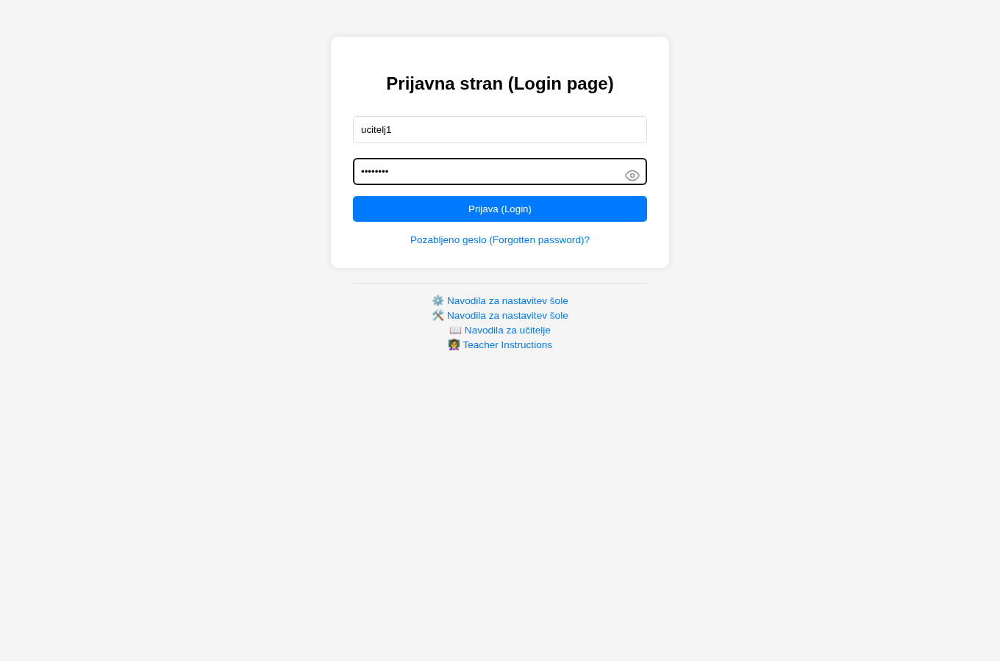
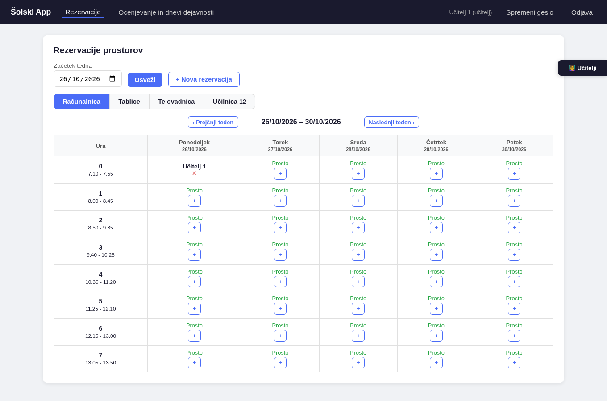
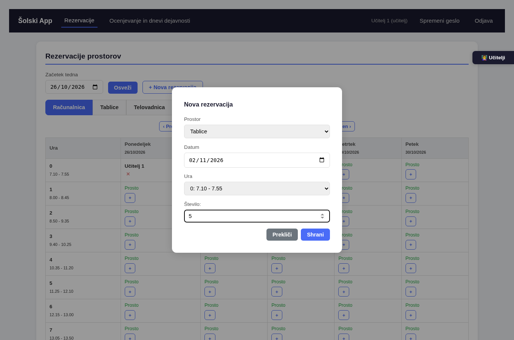
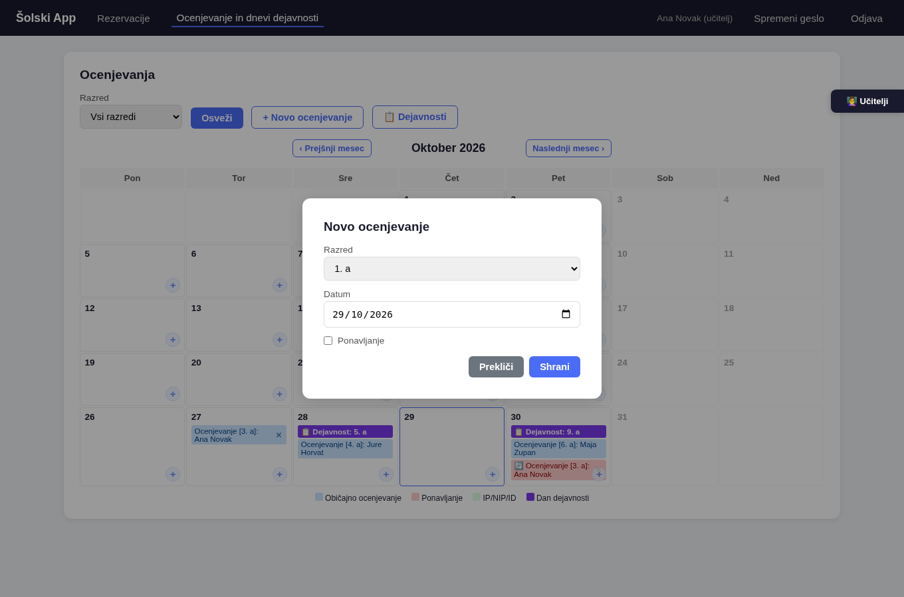
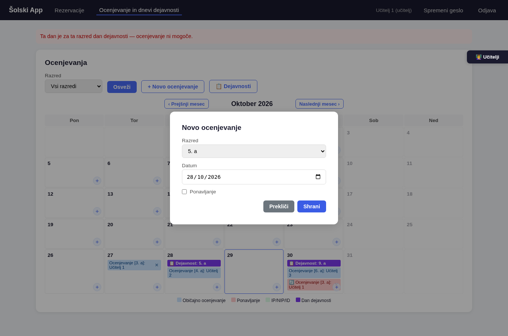
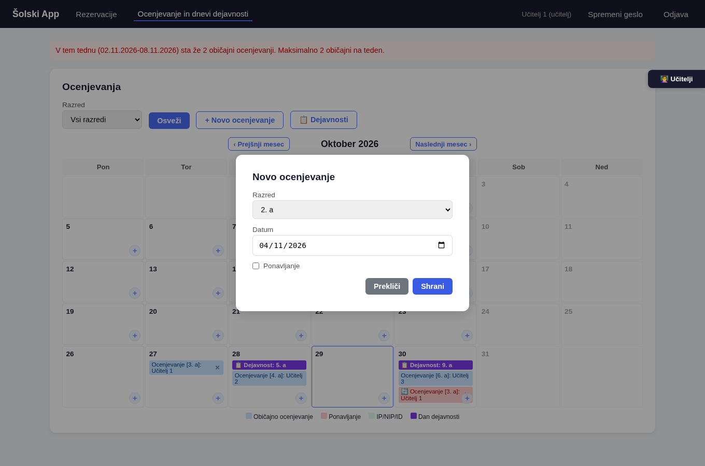
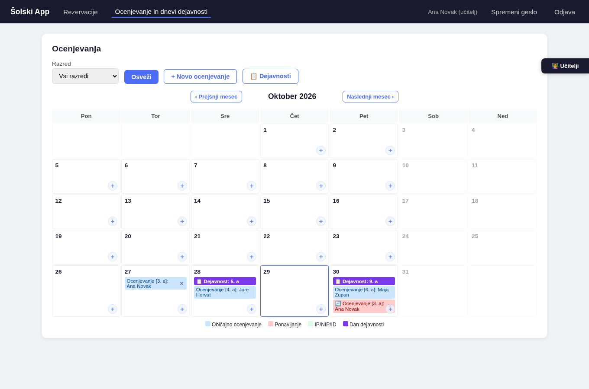
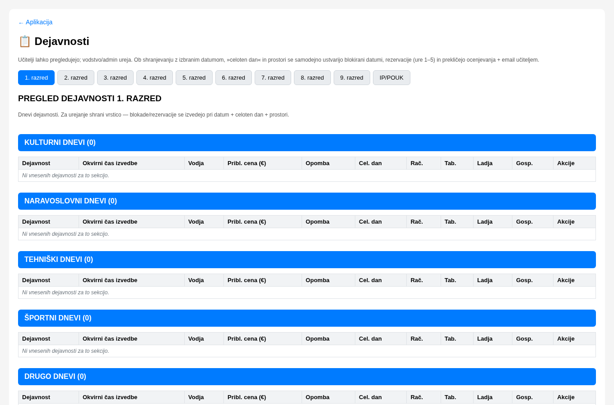
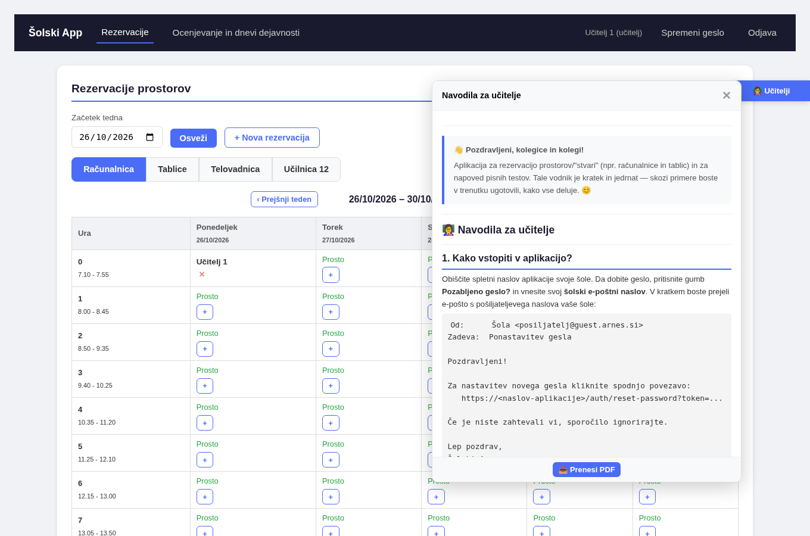

---

> 👋 **Pozdravljeni, kolegice in kolegi!**
>
> Aplikacija za rezervacijo prostorov/"stvari" (npr. računalnice in tablic) in za napoved pisnih testov. Tale vodnik je kratek in jedrnat — skozi primere boste v trenutku ugotovili, kako vse deluje. 😊

---

# 👩‍🏫 Navodila za učitelje

---

## 1. Kako vstopiti v aplikacijo?

Obiščite spletni naslov aplikacije svoje šole. Da dobite geslo, pritisnite gumb **Pozabljeno geslo?** in vnesite svoj **šolski e-poštni naslov**. V kratkem boste prejeli e-pošto s pošiljateljevega naslova vaše šole:

```text
Od:      Šola <posiljatelj@guest.arnes.si>
Zadeva:  Ponastavitev gesla

Pozdravljeni!

Za nastavitev novega gesla kliknite spodnjo povezavo:
   https://<naslov-aplikacije>/auth/reset-password?token=...

Če je niste zahtevali vi, sporočilo ignorirajte.

Lep pozdrav,
Šolski App

```

Če sporočila ne prejmete, javite administratorju, naj preveri, ali je vaš e-poštni naslov pravilno vnesen v bazo (v sporočilu navedite svoj pravilni e-poštni naslov).

---

## 2. Nastavitev gesla

V prejetem e-sporočilu kliknite na povezavo in nastavite novo geslo.

Geslo mora biti:
- ✅ Vsaj **5 znakov**
- ✅ Vsaj **ena mala črka**
- ✅ Vsaj **ena VELIKA črka**
- ✅ Vsaj **ena številka**

> 💡 **Primer:** `Sola2025` — lahko si zapomnite, vseeno dovolj varno.

---

## 3. Prijava

Ko ste geslo nastavili, se prijavite:

| Polje | Vnesite |
|---|---|
| **Uporabniško ime** | Vaš šolski e-poštni naslov |
| **Geslo** | Geslo, ki ste ga nastavili |

```text
Prijava v sistem

  Uporabniško ime:  [ vase.ime@guest.arnes.si ]
  Geslo:            [ •••••••• ]  (oko = prikaži/skrij)

  [ Prijava ]
  Pozabljeno geslo?  ·  Nova šola
```



> ⚠️ Če prijava ne deluje, najprej sami še nekajkrat poskusite ponastaviti geslo. Administratorja kontaktirajte šele, ko se težava ne reši.

> 💡 V meniju je tudi gumb **Spremeni geslo** (glej poglavje 7).

---

## 4. Rezervacije

Katere prostore lahko rezervirate, je odvisno od **nastavitev vaše šole**. Poznamo dve vrsti:

| Vrsta prostora | Kako deluje? |
|---|---|
| **Ekskluzivni prostor** | Samo **ena** rezervacija na termin (npr. računalnica) |
| **"Prostor" z več enotami** | Več učiteljev lahko rezervira **sočasno** — vsak navede količino, skupna vsota na uro pa je omejena s kapaciteto "prostora" (npr. tablice) |

```text
Stran »Rezervacije«

  [ Nova rezervacija ]              teden: 14. 9. – 18. 9. 2026

  Prostor        Pon    Tor    Sre    Čet    Pet
  ---------------------------------------------------------
  Računalnica     +      +      +      +      +
  Tablice       2/28     +      +      +      +
  ...
  (Pri vsakem prostoru in uri je gumb +; pri prostorih z več
   enotami je izpisano, koliko enot je še prostih, npr. 2/28.)
```



Rezerviramo lahko na **2 načina**:

**Način 1 — klik na gumb `+` v tabeli:**
Datum se samodejno nastavi na datum, pri katerem ste pritisnili `+` (datum lahko tudi ročno spremenite).

**Način 2 — klik na gumb `Nova rezervacija`:**
Vse podatke nastavite v oknu, ki se odpre.

```text
Okno »Nova rezervacija«

  Prostor:  [ spustni seznam ]
  Datum:    [ 14. 9. 2026 ]
  Ura:      [ 3. ura ]
  Količina: [ 5 ]        <- samo pri prostoru z več enotami

  [ Shrani ]   [ Prekliči ]
```



V tem oknu izberete **Prostor** iz spustnega menija; ure so po urniku vaše šole. Pri prostoru z več enotami izberete tudi **količino** — pri vsakem je prikazano, koliko enot je še prostih (oblika `x/N`).

> ⚠️ **Opomba:** Če je prostor z več enotami za posamezen termin že delno rezerviran, rezervacije prek gumba `+` ni mogoče izvesti — uporabite gumb **Nova rezervacija**.

**Brisanje rezervacije:**
Vodstvo ima pravico do brisanja **kakršnekoli** rezervacije, učitelji pa lahko brišejo **samo lastne**. Vodstvo ima možnost tudi serijskih rezervacij, priporočam da večino teh naredijo preko `/dejavnosti`. 

```text
Pregled rezervacij (tedenski koledar)

  Pon    Tor    Sre    Čet    Pet
  [R]    [R]     —     [T]     —
  R = vaša rezervacija        T = delno zaseden prostor z več enotami
```

---

## 5. Ocenjevanje

Ocenjevanje lahko napoveste na **2 načina**:

**Način 1 — s klikom na gumb `+` v koledarju:**
V koledarju ocenjevanj ima vsak delavnik v spodnjem desnem kotu celice gumb **`+`**. Klik nanj ustvari novo ocenjevanje — odpre se okno z **že izpolnjenim datumom** (razred in datum lahko spremenite). Gumb `+` se prikaže tudi, kadar je na ta dan že ocenjevanje ali dan dejavnosti.

**Način 2 — z gumbom `Novo ocenjevanje`:**
Ročno izberete razred in datum.

```text
Okno »Novo ocenjevanje«

  Razred:       [ 3. a ]
  Datum:        [ 14. 9. 2026 ]
  Ponavljanje:  [ ]   (obkljukaj pri popravljanju ocene / PIP)

  [ Shrani ]   [ Prekliči ]
```



**Ponavljanje:** Imate možnost tudi, da pisni test označite kot ponavljanje — tako drugače delujejo pravila za ocenjevanje.

**Pravila, ki jih sistem samodejno preverja (za razrede od 1. do 7.):**

| Pravilo | Opis |
|---|---|
| 📊 **Največ 1 test na dan** | Noben razred ne more pisati več kot en test na isti dan |
| ✏️ **Največ 2 običajna testa na teden** | Ponavljanje se ne šteje v to omejitev |
| 🗓️ **Največ 3 ocenjevanja skupaj na teden** | Vključno s ponavljanji |
| 🔄 **Ponavljanje dovoljuje 3. test v tednu** | Vendar trije zaporedni dnevi s testom niso dovoljeni |

**Kaj se zgodi, ko pravilo ni upoštevano?** Sistem tega ne dopusti: ob poskusu dodajanja ocenjevanja, ki bi krišilo katero od teh pravil, se prikaže **rdeče obvestilo**, ocenjevanje pa se ne shrani.


*Na dan, ko je razred označen kot dan dejavnosti, ocenjevanje ni mogoče — sistem to preveri že v brskalniku.*


*Ko razred že ima en test v tistem danu, drugega na isti dan ne morete dodati.*


*Ko so že dve običajni ocenjevanji v istem tednu, tretjo običajno ne morete dodati (ponavljanje se v to omejitev ne šteje).*

```text
Koledar ocenjevanj (mesec)

  Pon            Tor            Sre
  ─────────────────────────────────────────────
  14             15             16
  [Ocenjevanje]                 📋 Dejavnost: 3. a
  +              +              +

  Legenda:  modro = običajno ocenjevanje
            rdeče = ponavljanje
            zeleno = IP/NIP/ID
            vijolično = dan dejavnosti
            + = dodaj ocenjevanje
```



> ℹ️ Za **8. in 9. razred** (skupinsko-razredne oznake s črkami in številkami, kjer številke predstavljajo skupine) aplikacija teh pogojev ne preverja samodejno. Učitelji morate sami skrbeti za spoštovanje pravil glede na to, kdo je v kateri skupini in razredu.

> ℹ️ Za izbirni predmet je označen z drugo barvo in pri filtriranju prikazan za vse filtre od 6. razreda do 9. razreda, je pa treba preveriti pri učencih kdo dejansko piše na tisti datum.

---

## 6. Dnevi dejavnosti

Vodstvo lahko določene datume označi kot **dan dejavnosti** (npr. športni dan). Če ste imeli za ta dan že napovedano ocenjevanje, boste prejeli samodejno e-poštno obvestilo.

### 🟣 Vijolično polje »Dejavnosti:« v koledarju

V koledarju je pri dnevu, ko ima kateri od vaših razredov dejavnost, **vijolično
polje »Dejavnosti:«**. Klik na to polje odpre seznam vseh dejavnosti tega dne:

```text
Dejavnosti — 14. 9. 2026

  Razred   Dejavnost
  ─────────────────────────────────────────────
  3. a     Športni dan            [ Celoten dan ]
  3. b     Naravoslovni dan       [ Ne traja cel dan ]
```

Spodaj je primer pregleda dejavnosti, kot ga vidi učitelj:



V seznamu je za vsako dejavnost naveden **razred** in oznaka:

| Oznaka | Pomen |
|---|---|
| 🟣 **Celoten dan** | Dejavnost traja **ves dan** — na ta dan za ta razred ocenjevanja **niso mogoča**. Če ste jih imeli napovedana, so bila izbrisana in prejeli ste obvestilo. |
| 🟢 **Ne traja cel dan** | **Krajša** dejavnost — ocenjevanja so na ta dan **še vedno mogoča**, tako da mora učitelj sam preveriti ali je ta dejavnost ravno med vašo uro. |

> 💡 Tako na prvi pogled veste, kateri dan je »zaprt« za teste (cela dejavnost)
> in kdaj lahko test vseeno napoveste (krajša dejavnost).

Na strani za ocenjevanje je na voljo tudi **spustni meni za filtriranje**:
Izberete posamezen razred ali — za 8. in 9. razred — celotno generacijo. S filtri lažje pregledate, kateri dan kdo še lahko piše. Poleg tega je za izbirni predmet prikazan pri vseh razredih od 6. razreda naprej.

> 💡 **Opomba:** Po izboru filtra pritisnite gumb **Osveži**, da se prikažejo posodobljeni podatki.

---

---

## 6b. Moje govorilne ure (najava staršev)

Če vaša šola uporablja govorilne ure prek aplikacije, lahko sami **objavite svoj
termin** (dopoldanski dan, šolska ura, prostor in po želji popoldanski termin) na
strani **»🗓️ Moje govorilne ure«** v meniju.

Starši se nato najavijo sami prek javne povezave šole. Vse najave (datum, ura,
ime starša, ime otroka) vidite na isti strani — svoj termin lahko tudi izbrišete.
Prijave se samodejno počistijo **24 ur po koncu termina** (varovanje podatkov).

> 💡 Termin nastavite enkrat; starši izberejo prosto uro izmed vaših objavljenih.

---

## 7. Spreminjanje gesla


1. V meniju kliknite **Spremeni geslo**
2. Vnesite **trenutno geslo**
3. Vnesite **novo geslo** (upoštevajte pravila)
4. Potrdite novo geslo
5. Kliknite **Spremeni geslo**

> Ste pozabili geslo? Na prijavni strani kliknite **Pozabljeno geslo?**, dobite e-poštno sporočilo in spremenite geslo tam.

---

## 8. Dostop do teh navodil znotraj aplikacije

Na desni strani **aplikacije** je gumb **`👩‍🏫 Učitelji`**. Ko se z miško pomaknete nanj, se v manjšem oknu odprejo ta navodila, po katerih se lahko pomikate z miško. Na koncu okna je tudi gumb **Prenesi PDF**, s katerim si navodila prenesete na svoj računalnik.



```text
Desna stran aplikacije

  [ Učitelji ]   <- ob prehodu z miško se odpre predogled navodil
  [ Vodstvo ]      (vidno le vodstvu in adminu)
  [ Admin ]        (vidno le adminu)

  Na dnu okna:  [ Prenesi PDF ]
```

---

> 🫶 **Upam, da vam bo aplikacija v pomoč. Želim vam vse dobro pri uporabi!**
>
> **Avtor:** Matej Čušin
