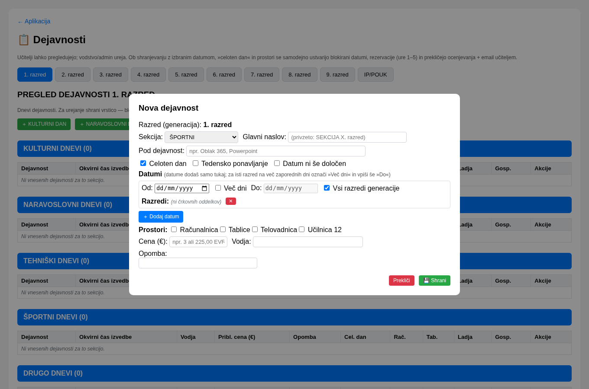
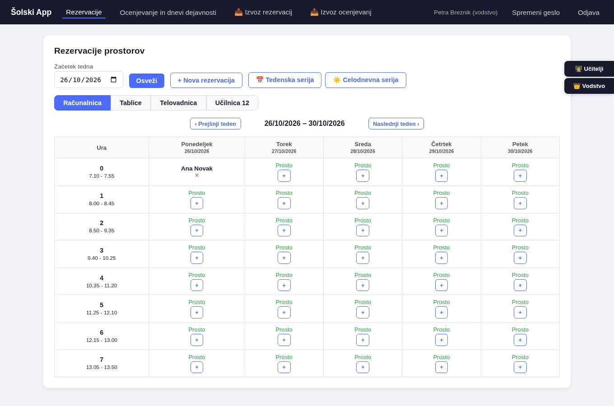

# 👑 Navodila za vodstvo

> Namenjeno **ravnatelju in pomočnikom ravnatelja**.  
> Vodstvo ima več moči kot učitelji — lahko brišete tudi tuje rezervacije, upravljate dneve dejavnosti in
> nadzorujete ocenjevanje. S tem pride tudi **odgovornost**.
>
> ⚡ **Hitri začetek:** Prijavite se s svojim šolskim računom. **Večino svojega dela opravljate na strani
> »Vnos dejavnosti« (`/dejavnosti`)** — tam nastavite dneve dejavnosti in tedenske serije. Vse, kar ni
> omenjeno spodaj, je enako kot za učitelje.

---

## 📝 Dnevi dejavnosti in serije — stran »Dejavnosti«

To je **glavna stran za vaše delo**. Do nje pridete prek zavihka **»Ocenjevanje in dnevi dejavnosti«**
oziroma neposredno na poti **`/dejavnosti`**. Ureja jo vodstvo in admin; učitelji jo vidijo samo za branje.

Spodaj je stran **»Dejavnosti«** z dnevi dejavnosti po razredih:

Tam nastavite:
- **dneve dejavnosti** (športni dan, kulturni dan, naravoslovni dan, tehniški dan, drugo),
- **tedenske serije** (redne tedenske rezervacije, npr. izbirni predmet vsak ponedeljek),
- **večdnevne dejavnosti** (npr. šola v naravi).

### Razredi (generacije) od 1. do 9. razreda

Dejavnosti so urejene **po razredih (generacijah) od 1. do 9. razreda** — vsak razred ima svoj zavihek
(poleg njih je še zavihek **IP/POUK** za posebne skupine). V vsaki vrstici termina izberete, za katere
**razrede (skupine)** dejavnost velja: posamezne oddelke (npr. `3. a`, `3. b`) ali kar
**»Vsi razredi generacije«**.

> ℹ️ Za **8. in 9. razred** se pogosto uporabljajo skupinsko-razredne oznake (npr. `8. a` in `8. 1`),
> kjer številka pomeni skupino.

### Kako dodate dejavnost (koraki)

1. Odprite zavihek **razreda** (npr. 3. razred).
2. Kliknite gumb za vrsto dejavnosti — **»＋ ŠPORTNI DAN«**, **»＋ KULTURNI DAN«**,
   **»＋ NARAVOSLOVNI DAN«**, **»＋ TEHNIŠKI DAN«** ali **»＋ DRUGO«** — oziroma
   **»＋ Dodaj dogodek / tedensko rezervacijo«**.
3. Izpolnite polja (glej tabelo spodaj).
4. Kliknite **💾 Shrani**. Dejavnost se takoj pojavi v seznamu in v koledarju.

### Polja obrazca

| Polje | Kaj pomeni |
|---|---|
| **Sekcija** | Vrsta dneva (KULTURNI / NARAVOSLOVNI / TEHNIŠKI / ŠPORTNI / DRUGO) |
| **Glavni naslov** | Ime dejavnosti (npr. »Športni dan«); če ga pustite prazno, se uporabi naziv sekcije |
| **Pod dejavnost** | Neobvezno — npr. »Oblak 365«, »Powerpoint« (za več pod-dejavnosti pod istim dnem) |
| **Celoten dan** | Ali dejavnost traja ves dan (glej spodaj) |
| **Tedensko ponavljanje** | Za redne tedenske rezervacije (serija) |
| **Datum ni še določen** | Če datuma še ne veste — vpišete le oceno termina (npr. »oktober–november«) |
| **Datumi** | Od (+ **Več dni** → **Do**), izbira razredov ali »Vsi razredi generacije« |
| **Dodaj datum** | Npr. vsak razred v generaciji ima drug dan isto dejavnost, torej lahko enkrat ustvarimo za več razredov, pri vsakem datumu lahko izbereš do datum  možnost in za kateri razred velja. |
| **Prostori** | Kateri prostori se rezervirajo (npr. telovadnica, računalnica), aplikacija v primeru, da je dejavnost označena `Celoten dan` rezervira izbrani prostor od 1. do 5. ure. |
| **Cena (€)** | Neobvezno (npr. okvirni strošek dejavnosti) |
| **Vodja** | Neobvezno (kdo vodi dejavnost) |
| **Opomba** | Neobvezno |

### Večdnevna dejavnost (npr. šola v naravi)

1. V razdelku **Datumi**: 
2. Vpišite **Od** (prvi dan).
3. Obkljukajte **»Več dni«** in v polje **Do** vpišite **zadnji dan**.
4. Shranite — dejavnost velja za **vsak zaporedni dan v tem obsegu**; vsak dan se zablokira
   za ocenjevanja in (ob izbranih prostorih) rezervira ure 1–5.
5. Če imamo več izvedb iste dejavnosti **+ Dodaj datum`** za vsak datum (oz za vsako obdobje Od, Do) določite za katere razrede ta dejavnost velja.

### Celi dan ali krajša dejavnost

- **»Celoten dan«** (obkljukano): dan se **zablokira za ocenjevanja**, obstoječa napovedi ocenjevanj se izbrišejo
  (učitelji dobijo e-pošto); ob izbranih prostorih se **rezervirajo ure 1–5**, prav tako v primeru da rezervacije obstajajo, za termin ko poteka dejavnost jih aplikacija prekliče in prizadeti učitelj, ki je ustvaril rezervacijo dobi e-pošto.
- **Brez kljukice**: **krajša** dejavnost — ocenjevanja **niso** blokirana in dan se v koledarju
  ne prikaže kot blokada, mora pa učitelj sam preveriti, da dogodek ne poteka ravno med njegovo uro.

### Tedensko ponavljanje (serija)

Obkljukajte **»Tedensko ponavljanje«**, da se dejavnost/rezervacija ponovi vsak teden na isti dan v
izbranem obdobju (npr. vsak ponedeljek 1. uro v računalnici). To je priročno za reden pouk. 

### Kaj se zgodi, ko shranite

1. Sistem **samodejno izbriše** vsa obstoječa ocenjevanja izbranih razredov v tem obdobju.
2. Prizadeti učitelji **avtomatsko prejmejo e-poštno obvestilo**.
3. Ob izbranih prostorih se **rezervirajo ure 1–5**, v primeru obstoječih rezervacij se le te tudi odpovedo, če jih rabijo v dejavnosti.
4. Vse se zabeleži v dnevniku sprememb.

Ni vam treba ničesar najavljati posebej — sistem obvesti namesto vas.

> 🟣 **Ročna blokada v koledarju:** če želite dan zablokirati **brez** zapisa v dejavnostih, ga
> označite v **koledarju** na glavni strani (gumb za dneve dejavnosti — izberete razrede in obdobje).
> Taka blokada v dejavnostih nima zapisa (v koledarju piše »ročno blokirano«).

---

## 📅 Rezervacije

Poleg dejavnosti na strani **`/dejavnosti`** lahko posamezne rezervacije urejate tudi v koledarju
na glavni strani (enako kot učitelji), a z dodatnimi pravicami:

| Vloga | Lahko briše |
|---|---|
| Učitelj | Samo svoje rezervacije |
| **Vodstvo** | **Svoje + tuje** rezervacije |

| Gumb | Kaj naredi |
|---|---|
| **`+`** v celici koledarja | Hitro ustvari rezervacijo za ta datum |
| **Novo rezervacija** | Odpre okno za rezervacijo (prostor, datum, ura, količina) |
| **✕** na rezervaciji | Izbriše rezervacijo (svojo ali — kot vodstvo — tujo) |
| **Osveži** | Ponovno naloži prikazane podatke |

Na posnetku spodaj vodstvo vidi rezervacije vseh učiteljev (ne le svojih):

**Vodstvo ima več moči — lahko brišete tudi tuje rezervacije. S tem pride odgovornost.**
Preden zbrišete učiteljevo rezervacijo, premislite.

### Obvestila po e-pošti

Sistem **samodejno pošilja e-poštna obvestila** vedno, ko vodstvo:

| Akcija | Kdo dobi e-pošto | Zakaj? |
|--------|------------------|--------|
| Označi datum kot **dan dejavnosti**  in `Celoten dan`| Vsi učitelji, katerih ocenjevanje se je izbrisalo | Da vedo, da morajo najti drug datum |
| Ustvari **tedensko serijo** | Učitelji s konfliktnimi rezervacijami | Dobijo obvestilo, da je njihova rezervacija odpovedana |

> ⚠️ **Pomembno:** Če posamezno rezervacijo izbrišete kar z `✕`, **nihče ne dobi obvestila**. Za
> avtomatska obvestila uporabite **dneve dejavnosti** ali **serije** — sistem sam obvesti vse prizadete.

---

## 📥 Izvoz podatkov v CSV

> **Kaj je to?** Izvoz v CSV (Excelu prijazna oblika) — podatke prenesete na svoj računalnik in jih
> odprete v Excelu, Google Sheets ali podobnem programu.

| Vrsta izvoza | Kam kliknete | Kateri podatki |
|---|---|---|
| **Rezervacije prostorov** | 📥 Izvoz rezervacij (v meniju) | Datum, ura, prostor, razred, učitelj |
| **Ocenjevanja in dnevi dejavnosti** | 📥 Izvoz ocenjevanj (v meniju) | Datum, razred, tip ocenjevanja, učitelj |

1. V zgornjem meniju kliknite **📥 Izvoz rezervacij** ali **📥 Izvoz ocenjevanj**.
2. Izberite **obdobje** (privzeto zadnji mesec): **Od datuma** in **Do datuma**.
3. Pri rezervacijah lahko izberete tudi **prostor** (ali pustite »Vsi prostori«).
4. Kliknite **📥 Prenesi CSV**.

> **Namig:** CSV uporablja podpičje (`;`) kot ločilo, kar Excel v slovenščini samodejno prepozna.
> Če se vam zdi zmešano v en stolpec, pri uvozu izberite **ločilo: podpičje**.

---

## 🎯 Priporočila za vloge

> Pravilna dodelitev vlog preprečuje težave in zlorabe.

| Vloga | Kdo naj jo ima | Pravice |
|---|---|---|
| **Vodstvo** | Ravnatelj, pomočniki | Rezervacije serij, brisanje tujih rezervacij, dnevi dejavnosti |
| **Učitelj** | Vsi pedagoški delavci | Osnovne rezervacije in ocenjevanje |

**Z eno besedo:** vodstvo skrbi za urnik in dneve dejavnosti, učitelji skrbijo za pouk.

---

> **Avtor:** Matej Čušin
